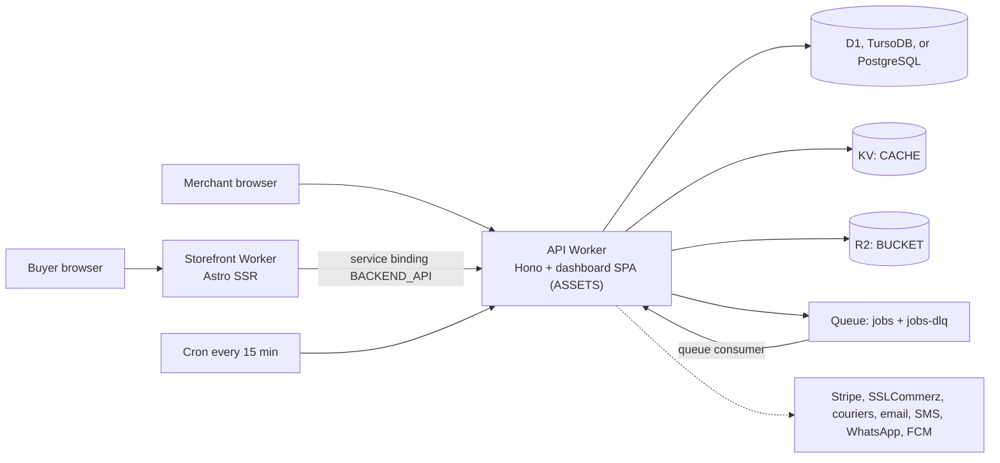

# Scalius Commerce Lite

Scalius Commerce Lite is a self-hosted commerce platform: a merchant dashboard, a storefront, and an API. It runs as two Cloudflare Workers on D1, TursoDB, or PostgreSQL. This page is for operators who deploy a store and contributors who work on the code.

- Website: <https://scalius.com>
- Help and questions: [Discord](https://scalius.com/discord)
- Bugs and proposals: [GitHub issues](https://github.com/scaliuslabs/scalius-commerce-lite/issues)
- License: [AGPL v3](LICENSE). The storefront in `apps/storefront/` is MIT-licensed.

## Stack

A Turborepo monorepo. The dashboard is a React 19 SPA, the storefront is Astro 7 SSR, and the API is Hono with `@hono/zod-openapi` and Better Auth (optional TOTP and email OTP 2FA). Drizzle ORM runs on D1 (default), TursoDB or PostgreSQL/Neon. Built-in providers: Stripe, SSLCommerz, cash on delivery, Pathao, Steadfast, Cloudflare Email, Resend, four SMS providers, WhatsApp and FCM push. `@scalius/plugin-sdk` builds plugins.

## Repository layout

```text
apps/
  admin-v2/     @scalius/admin-v2    Dashboard SPA; no Worker of its own (dev :4323)
  api/          @scalius/api         API Worker: Hono routes, queue consumer, cron, serves the dashboard (dev :8787)
  storefront/   @scalius/storefront  Storefront Worker: Astro SSR (dev :4322)
packages/
  api-client/   Generated SDK from the API's OpenAPI spec
  cli/          `scalius` CLI: operates a deployed store through its OpenAPI contract
  core/         Domain services (src/modules/<domain>), auth, provider integrations
  database/     Drizzle schema, migrations, provider adapters
  plugin-sdk/   Plugin authoring kit (bundled and sandboxed installs)
  shared/       Pure utilities shared by the Workers and the dashboard
  tsconfig/     Shared TypeScript configs
plugins/        Reference plugins: bkash, bulk-discount, hello, loyalty, nagad, order-tagger, wishlist
scripts/        Dev tooling, deploy pipeline, release and ops checks
docs/           Architecture, plan profile, database portability, performance, providers
tests/          Cross-package unit tests (tests/README.md)
scalius.plugins.json   Lockfile of the plugins compiled into the API Worker (`pnpm plugin`)
```

## Architecture



- The API Worker serves `/api/v1/*`, Better Auth (`/api/auth/*`), and the built dashboard (`apps/admin-v2/dist`) on the dashboard host.
- The storefront Worker has no database, provider, or URL configuration. It calls the API Worker through `BACKEND_API`, and each page renders from one `GET /api/v1/storefront/batch` call.
- Public reads use dependency validation (DVC), not purges: [packages/core/src/cache-deps/README.md](packages/core/src/cache-deps/README.md).

[docs/ARCHITECTURE.md](docs/ARCHITECTURE.md) covers domains, layers, the order lifecycle, and invariants.

## Local development

### Prerequisites

- Node.js 24 (pinned in `.nvmrc`; run `nvm use`).
- pnpm 11.20 (pinned in `package.json` `packageManager`; run `corepack enable`).
- Mailpit, the local inbox for email and OTP (`brew install mailpit`). `pnpm dev` starts it and fails when it is missing.
- A Cloudflare account, only to deploy.

### Setup

```bash
nvm use
pnpm install
pnpm dev:setup
pnpm dev
```

`pnpm dev:setup` writes the two secrets to `apps/api/.dev.vars` and `apps/storefront/.dev.vars` (git-ignored), applies local D1 migrations, and creates a local admin through `/api/v1/setup`. It writes no URLs. The default admin is `admin@local.scalius.test` with password `ScaliusLocal123!`. Override it with `--admin-email`, `--admin-password`, `--admin-name`, or `LOCAL_ADMIN_EMAIL`, `LOCAL_ADMIN_PASSWORD`, `LOCAL_ADMIN_NAME`.

`pnpm dev` runs a doctor preflight, starts or reuses Mailpit, applies local D1 migrations (skip with `SCALIUS_SKIP_DEV_MIGRATIONS=1`), points the local Platform settings at the local ports, then starts the API, the dashboard and the storefront. It refuses to start when a port is in use.

| URL | Service |
|-----|---------|
| `http://localhost:4323/admin` | Dashboard |
| `http://localhost:4322` | Storefront |
| `http://localhost:8787/api/v1/docs` | Swagger UI (spec at `/api/v1/openapi.json`, health at `/api/v1/health`) |
| `http://127.0.0.1:8025` | Mailpit inbox |

`pnpm dev:doctor` reports on Node, secrets, database state, and ports without changing anything. Add a profile after you start servers: `dev:doctor:api`, `dev:doctor:admin`, `dev:doctor:storefront`, or `dev:doctor:all`.

### Parallel local stacks

`scripts/dev-ports.mjs` is the one source of the dev ports: `SCALIUS_DEV_API_PORT`, `SCALIUS_DEV_STOREFRONT_PORT`, and `SCALIUS_DEV_ADMIN_PORT` (defaults 8787, 4322, 4323). Never set them as Wrangler `vars`. To run a second stack, give it its own ports and state directory:

```bash
pnpm dev --api-port 8931 --storefront-port 4531 --admin-port 4532 --state /tmp/slot/state
```

`scripts/dev.sh` runs `node scripts/dev-ports.mjs sync-platform` before the API starts. It replaces only unset or loopback Platform origins, so an origin you saved in the dashboard stays. Wrangler's dev registry is machine-wide, so an API on a non-default port runs as `scalius-api-local-<api port>`. The header of `scripts/dev-ports.mjs` lists the other subcommands (`api-worker-name`, `storefront-config`, `verify-binding`).

To start one app alone, export the three port variables and `SCALIUS_WRANGLER_STATE`, run `sync-platform` while the API is stopped, then run `pnpm --dir <app> dev`.

## Commands

Run every command from the repository root.

| Command | Purpose |
|---------|---------|
| `pnpm dev`, `dev:api`, `dev:admin`, `dev:storefront` | Start the full stack, or the API with one app |
| `pnpm dev:setup [--env-only] [--force]` | Create or repair local secrets, migrate, create the admin |
| `pnpm dev:reset [--state <dir>]` | Delete local D1, KV, and R2 state, migrate, recreate the admin |
| `pnpm dev:admin:create`, `dev:admin:reset`, `dev:admin:status` | Manage the local admin |
| `pnpm db:generate` | Generate Drizzle migrations after a schema change |
| `pnpm db:migrate:local`, `db:migrate:remote` | Apply pending migrations to local or remote D1 |
| `pnpm typecheck` | One TypeScript 7 `tsc --build` over every project (project references), then `astro check` for the storefront |
| `pnpm lint` | Oxlint with type-aware rules over the repository (`.oxlintrc.json`), then ESLint for `.astro` files and the dashboard design rules |
| `pnpm test` | Vitest for the whole repository ([tests/README.md](tests/README.md)) |
| `pnpm check:env` | Fail on Wrangler `vars`, bindings outside the allowed set, and a missing `CF_VERSION_METADATA` |
| `pnpm generate:sdk` | Regenerate the agent operation manifest and `@scalius/api-client`; commit the output |
| `pnpm build` | Build every workspace |
| `pnpm plugin <command>` | Create, add, remove, list, and build bundled plugins; `pnpm plugin sandbox on\|off` |
| `pnpm run deploy` | Deploy the API Worker (with the dashboard) and the storefront Worker |
| `pnpm ops:check` | Read-only production API smoke check |
| `pnpm release:check` | Read-only release smoke check: API, dashboard, storefront, discovery files, UCP |

Use `pnpm run deploy`, not `pnpm deploy`, which is a different pnpm command. `pnpm ops:check` and `pnpm release:check` default to the maintainers' hosts. Pass your own URLs ([Verify](#5-verify)).

The root `package.json` lists the other scripts. Their docs: `perf:storefront` and `catalog-scale-seed.mjs` in [docs/STOREFRONT-PERFORMANCE.md](docs/STOREFRONT-PERFORMANCE.md); `free-plan:budget` in [docs/FREE-PLAN.md](docs/FREE-PLAN.md); `secret:derive`, `auth:handoff-token`, and `demo:store` in [docs/AUTOMATED-DEPLOYMENTS.md](docs/AUTOMATED-DEPLOYMENTS.md).

## Configuration

A deployment has two installed secrets, no Wrangler `vars`, and every other setting in the dashboard.

### Installed secrets

| Secret | Worker | Purpose | Generate with |
|--------|--------|---------|---------------|
| `SCALIUS_SECRET` | API, storefront | Master secret, identical on both; at least 32 characters | `openssl rand -base64 48` |
| `CREDENTIAL_ENCRYPTION_KEY` | API | AES-256-GCM key for stored provider credentials, plugin secret settings, gift-card codes, licence keys, and webhook secrets; base64 of 32 bytes | `openssl rand -base64 32` |

At entry, each Worker derives every per-purpose secret (session, JWT, service token, agent token pepper, customer session hash key and three opt-in automation keys) from `SCALIUS_SECRET` with HKDF-SHA256 (`packages/shared/src/runtime-secrets.ts`). Derived values are never installed, stored, or logged.

Without `SCALIUS_SECRET`, the API answers every request with `503 RUNTIME_SECRET_MISSING`, except `/api/v1/health`, `/api/v1/readyz`, and `/api/v1/meta`.

- Rotating `SCALIUS_SECRET` rotates every derived secret. Admins sign out, service tokens stop verifying, and agent credentials need reissue. Data encrypted with `CREDENTIAL_ENCRYPTION_KEY` survives.
- Rotating `CREDENTIAL_ENCRYPTION_KEY` makes everything encrypted with it unreadable. Re-enter every provider credential in the dashboard.

### Platform settings

Public origins are database-backed settings, not environment variables. The API Worker composes `env.STOREFRONT_URL`, `env.PUBLIC_API_BASE_URL`, `env.BETTER_AUTH_URL`, `env.R2_PUBLIC_URL`, `env.CDN_DOMAIN_URL`, and `env.CORS_ALLOWED_ORIGINS` from them at entry (`apps/api/src/runtime/runtime-env.ts`). Never configure those names in Wrangler or `.dev.vars`.

| Setting | Dashboard location | Purpose |
|---------|--------------------|---------|
| Store address (`storefrontUrl`) | Settings > Store details > Web addresses | Canonical storefront origin (links, sitemaps, feeds) |
| Server address (`apiUrl`) | Same | Public API origin for browsers and payment providers |
| Dashboard address (`dashboardUrl`) | Same | Dashboard origin; may carry a path prefix such as `/dashboard` |
| Image address (`mediaUrl`) | Same | Public base URL of the media bucket's custom domain |
| Shared sign-in domain | Settings > Advanced > Sign-in and access | `Domain` of customer session cookies across subdomains |
| Sites allowed to call your store | Same | Extra CORS origins for credentialed API requests |
| Setup key for the first admin | Same | Gates `POST /api/v1/setup` behind a derived token |
| Single sign-on | Same | Identity handoff (issuer, audience, JWKS URL, password sign-in lock) |

The setup key and single sign-on are opt-in contracts ([docs/AUTOMATED-DEPLOYMENTS.md](docs/AUTOMATED-DEPLOYMENTS.md)). Leave them off for a hand-installed store. `GET /api/v1/platform` returns the four origins and the two opt-in flags (`Cache-Control: no-store`). `GET /api/v1/readyz` reports a `platform_config` problem until all four origins are set.

Provider and integration settings live in the dashboard under Settings > Payments, Shipping and delivery, Notifications and Integrations.

### Database provider

D1 is the default and is bound in the committed Wrangler config. For another provider, install these secrets on the API Worker:

- TursoDB: `TURSO_DATABASE_URL` and `TURSO_AUTH_TOKEN`.
- PostgreSQL: `POSTGRES_DATABASE_URL`, or bind `HYPERDRIVE` with query caching disabled (`--caching-disabled`).
- `DATABASE_PROVIDER` (`d1`, `turso`, or `postgres`) pins the provider. It is required when both Turso and PostgreSQL credentials are installed.

Changing the provider of a live store is a freeze, snapshot, import, and verify procedure, not a credential swap: [docs/DATABASE-PORTABILITY.md](docs/DATABASE-PORTABILITY.md).

## Deployment

### 1. Create the Cloudflare resources

The committed `apps/api/wrangler.jsonc` and `apps/storefront/wrangler.jsonc` hold the names and IDs of the maintainers' account. Create each resource in your account and replace them.

| Resource | Worker | Binding |
|----------|--------|---------|
| D1 database (`migrations_dir` is `packages/database/migrations`) | API | `DB` |
| KV namespace (the only one; OAuth keys use the `oauth:` prefix) | API | `CACHE` |
| R2 bucket (media under `media/`, sealed agent artifacts under `private/agent-artifacts/`) | API | `BUCKET` |
| Queues `jobs` and `jobs-dlq` | API (producer, both consumers) | `JOBS_QUEUE` |
| Rate limiters: strict 5 per 60 s, standard 60 per 60 s (counters are account-wide per `namespace_id`: use your own IDs) | API | `RL_STRICT`, `RL_STANDARD` |
| Email sending | API | `EMAIL` |
| Images | API | `IMAGES` |
| Service binding to `scalius-api` | Storefront | `BACKEND_API` |
| Static assets (`apps/admin-v2/dist`) | API | `ASSETS` |

- The API config sets `placement.region` beside the D1 primary. Change it when your database lives elsewhere.
- Both Workers set `workers_dev: false`, so each needs a custom domain. The storefront declares its domain in `routes`. Point the API host and the dashboard host at `scalius-api` in the Cloudflare dashboard.
- Attach a public custom domain to the media bucket. On that hostname, add a WAF rule that blocks paths starting with `/private/`. Add an R2 lifecycle rule that deletes `private/agent-artifacts/` objects after one day, as a backstop for the cron cleanup.
- Keep the Wrangler configs to bindings only.

### 2. Install the secrets

Wrangler prompts for each value and writes nothing to disk.

```bash
pnpm --dir apps/api exec wrangler secret put SCALIUS_SECRET
pnpm --dir apps/api exec wrangler secret put CREDENTIAL_ENCRYPTION_KEY
pnpm --dir apps/storefront exec wrangler secret put SCALIUS_SECRET
```

### 3. Deploy

```bash
pnpm run deploy --api-url https://api.example.com --storefront-url https://shop.example.com
```

The pipeline runs these steps in order:

1. Typecheck all workspaces, one at a time.
2. Build all workspaces (the dashboard first, because it is the API Worker's static assets), then run the dist secret and build canary checks.
3. Apply D1 migrations. For TursoDB or PostgreSQL, run a read-only schema check instead (pass `--database-target-host`).
4. Deploy the API Worker, then the storefront Worker, and verify each one live.

| Option | Effect |
|--------|--------|
| `--only api` or `--only storefront` | Deploy one Worker (`pnpm run deploy:api`, `deploy:storefront`) |
| `--plan paid` | Workers Paid profile: CPU limit, larger queue batches. The default is Free ([docs/FREE-PLAN.md](docs/FREE-PLAN.md)) |
| `--plugin-sandbox` | Bind the Worker Loader for sandboxed plugins (Workers Paid; implies `--plan paid`) |
| `--dry-run` | Typecheck, build, and run the dist checks only |

The Wrangler configs carry no `vars`, so the script learns your origins from its arguments:

| Origin | Resolution order |
|--------|------------------|
| API | `--api-url` or `SCALIUS_API_URL` |
| Storefront | `--storefront-url` or `SCALIUS_STOREFRONT_URL`, then the `custom_domain` route in `apps/storefront/wrangler.jsonc`, then the Platform `storefrontUrl` read from the API |

Without an API origin, the deploy succeeds but skips live `/health` and `/readyz` verification and cache warming. The script warns when the deploy target and the Platform `storefrontUrl` differ.

### 4. Complete Platform settings

1. Open the dashboard and create the first admin at `/auth/setup`.
2. Fill the four web addresses in Settings > Store details.

Until you do, `/api/v1/readyz` reports a `platform_config` problem. The storefront's credentialed features (cart, customer sign-in) fail, because CORS and cookie settings derive from these origins.

### 5. Verify

```bash
curl https://api.example.com/api/v1/readyz
curl https://api.example.com/api/v1/meta
pnpm ops:check --api-base-url https://api.example.com
pnpm release:check --api-base-url https://api.example.com --storefront-url https://shop.example.com --dashboard-url https://dashboard.example.com
```

`GET /api/v1/meta` reports the release, the supported API majors, the database provider, and whether the applied schema matches this build. Add `--queues` to `ops:check` to verify the queue wiring. Add `--skip-wrangler` to either check to skip the Wrangler deployment proof.

## Troubleshooting

| Problem | Fix |
|---------|-----|
| Port in use on `pnpm dev` | The wrapper prints the port, PID, and command. Stop that process and rerun |
| Forgot the local admin password | `pnpm dev:admin:reset` |
| Local sign-in loops | `pnpm dev:admin:reset`, then `pnpm dev:setup --env-only` (add `--force` when the shared local secrets differ) |
| Local D1 errors | `pnpm dev:reset` |
| `503 RUNTIME_SECRET_MISSING` | `SCALIUS_SECRET` is missing or shorter than 32 characters. Run `wrangler secret put SCALIUS_SECRET`, or `pnpm dev:setup --env-only` locally |
| `/api/v1/readyz` reports `platform_config` | Set the missing origins in Settings > Store details |
| Cart or sign-in fails with CORS or cookie errors | The Platform origins are wrong or unset |
| Provider credentials do not decrypt | `CREDENTIAL_ENCRYPTION_KEY` changed. Re-enter the credentials in the dashboard |
| `pnpm check:env` fails | Delete the Wrangler `vars` block or the extra binding. URLs belong in Platform settings; secrets use `wrangler secret put` |
| Stale SDK types | Run `pnpm generate:sdk` |

## Documentation

| Document | Covers |
|----------|--------|
| [docs/ARCHITECTURE.md](docs/ARCHITECTURE.md) | Domains, layers, runtime configuration, order lifecycle, invariants |
| [docs/FREE-PLAN.md](docs/FREE-PLAN.md) | Workers Free and Paid plan profile, limits, live checks |
| [docs/AUTOMATED-DEPLOYMENTS.md](docs/AUTOMATED-DEPLOYMENTS.md) | Opt-in contracts for managed installs |
| [docs/DATABASE-PORTABILITY.md](docs/DATABASE-PORTABILITY.md) | Database runtime contract and provider cutover |
| [docs/STOREFRONT-PERFORMANCE.md](docs/STOREFRONT-PERFORMANCE.md) | Page render path, per-page budgets, `pnpm perf:storefront` |
| [docs/PERFORMANCE-RELEASE.md](docs/PERFORMANCE-RELEASE.md) | Release performance baseline |
| [packages/shared/src/storefront-theme.md](packages/shared/src/storefront-theme.md) | Storefront theme document and the online store builder |
| [docs/delivery-providers/README.md](docs/delivery-providers/README.md) | Pathao and Steadfast contracts |
| [docs/PLACES.md](docs/PLACES.md) | The place directory, its datasets and their import |
| [docs/MARKETS-DESIGN.md](docs/MARKETS-DESIGN.md) | Markets design (not built) |
| [apps/admin-v2/README.md](apps/admin-v2/README.md), [apps/admin-v2/DESIGN.md](apps/admin-v2/DESIGN.md) | Dashboard app and design rules |
| [apps/storefront/README.md](apps/storefront/README.md) | Storefront app |
| [packages/plugin-sdk/README.md](packages/plugin-sdk/README.md) | Plugin authoring |
| [packages/cli/README.md](packages/cli/README.md) | The `scalius` CLI |
| [packages/database/README.md](packages/database/README.md) | Schema, migrations, providers |

## Contributing, security, conduct

- [CONTRIBUTING.md](CONTRIBUTING.md): issue forms and contribution policy
- [SECURITY.md](SECURITY.md): report a vulnerability
- [CODE_OF_CONDUCT.md](CODE_OF_CONDUCT.md)
